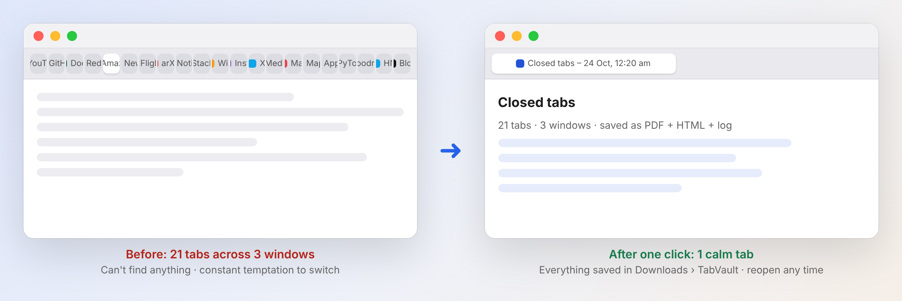
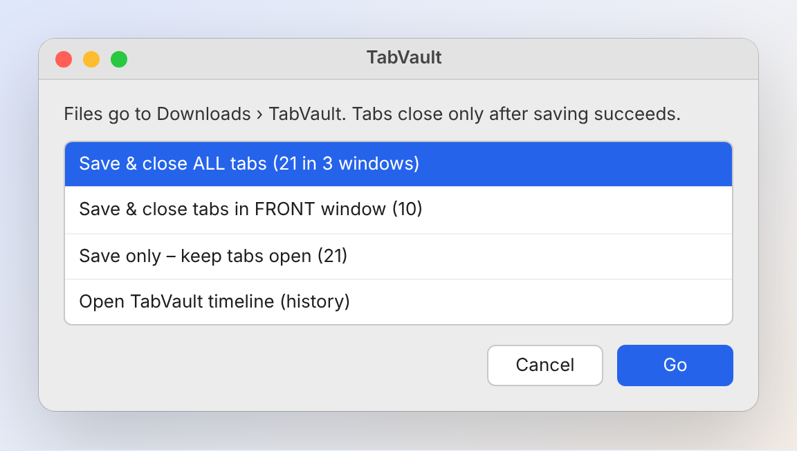
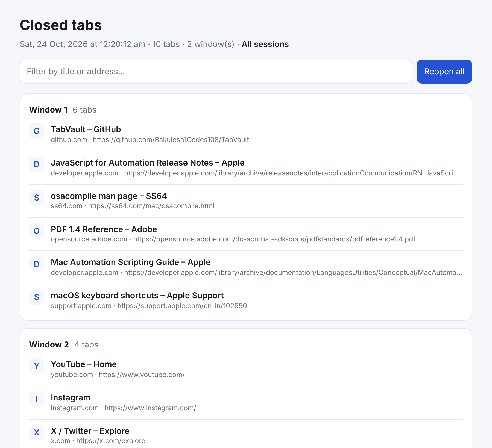
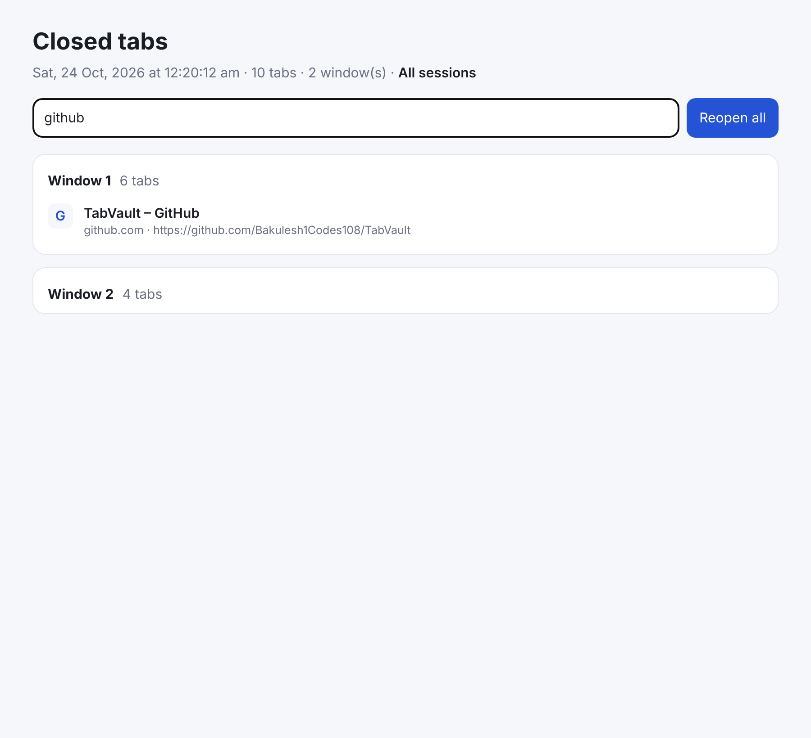
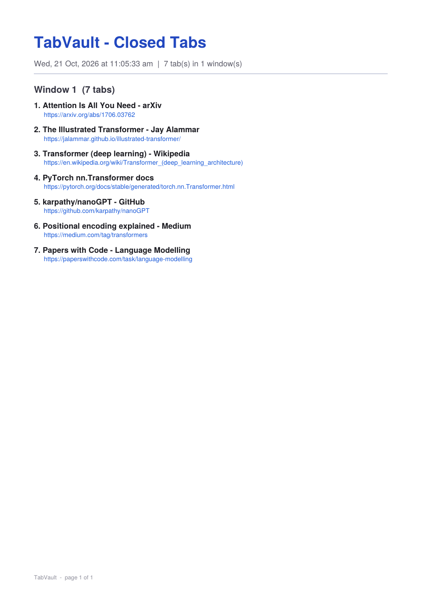
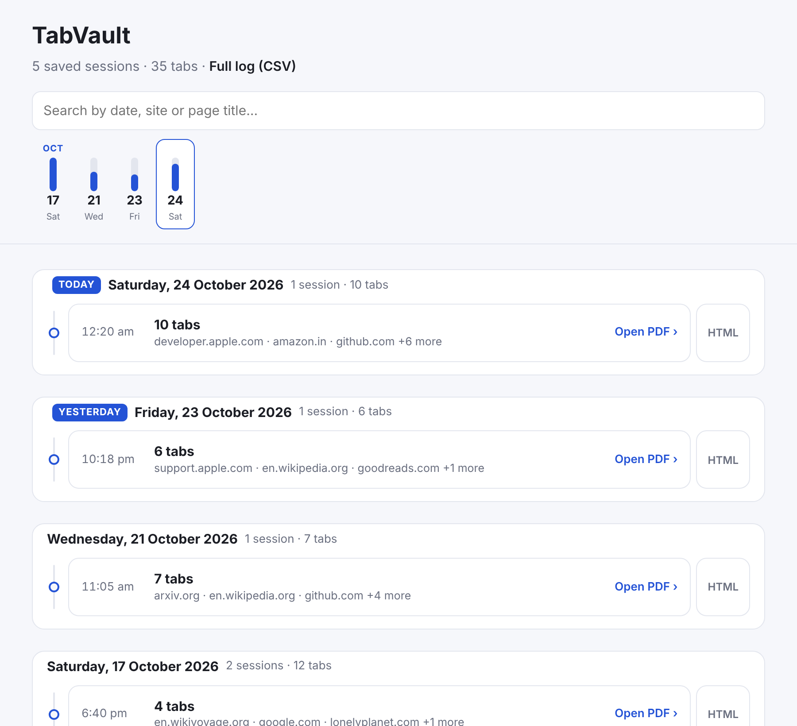
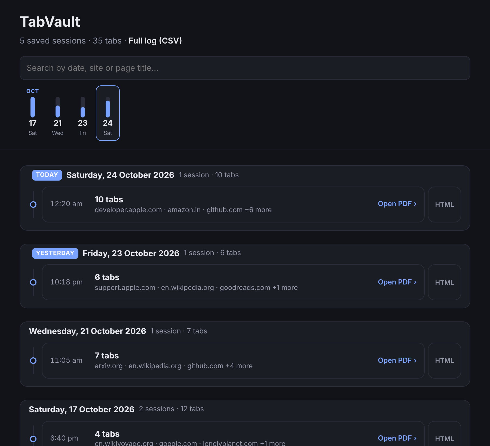
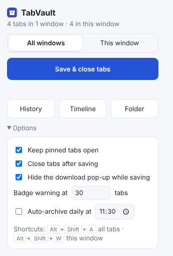
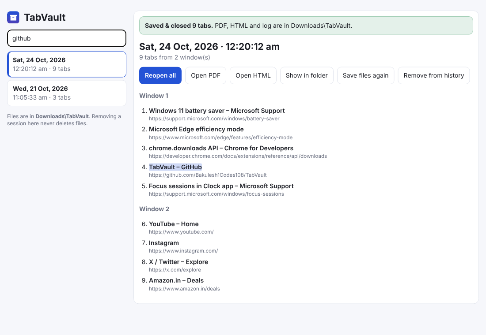
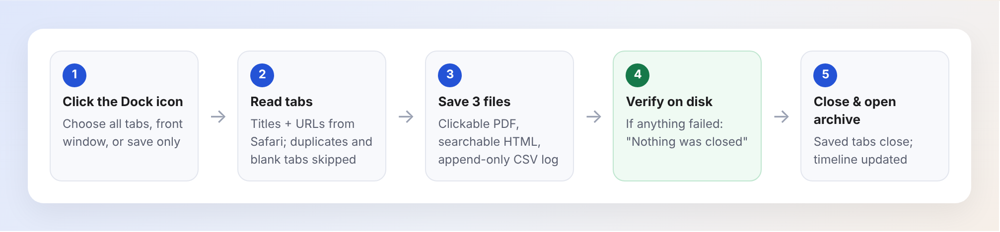

# TabVault

**One click saves every open browser tab to a clickable PDF, a searchable web page and a log — then closes them, so you can get back to work.**

Available for **macOS (Safari)** and **Windows (Chrome & Microsoft Edge)**.

    



TabVault is a tiny Mac Dock app (and a Chrome/Edge extension on Windows) for people who keep dozens of tabs open "just in case". Open tabs are a to-do list that never ends: they pull your attention, slow Safari down and drain the battery. TabVault lets you close them **without the fear of losing anything** — every tab is kept in `~/Downloads/TabVault` with the date and time it was closed.

No Xcode, no dependencies, no background process, no network access. The whole app is a single JavaScript for Automation (JXA) file.

> All screenshots in this README use sample tabs, not real browsing history.

---

## Contents

- [Use cases](#use-cases)
- [See it in action](#see-it-in-action)
- [Recommended routines](#recommended-routines)
- [Windows version (Chrome & Edge)](#windows-version-chrome--edge)
- [Features](#features) · [Timeline](#timeline) · [Install (Mac)](#install-mac) · [Windows](#windows-version-chrome--edge) · [What gets saved](#what-gets-saved) · [How it works](#how-it-works) · [Privacy](#privacy)

---

## Use cases

### 1. Deep-work reset — remove distractions in one click
You sit down to focus but YouTube, Instagram, news and shopping tabs are still open from earlier. Choose **Save & close ALL tabs**. Safari is left with a single page — the archive — and nothing else competing for your attention. Because the tabs are saved, there is no "I'll just keep it open in case" excuse.

### 2. End-of-day shutdown ritual
Close the laptop with a clean slate. Archive everything at the end of the day; tomorrow you start fresh, and yesterday's tabs are one click away on the **timeline** under *Yesterday*.

### 3. Research sprints (study, papers, coding)
Researching a topic opens 10–30 tabs: docs, papers, Stack Overflow, GitHub. When the sprint is done, archive them. The session becomes a **reading list as a PDF** with clickable links — easy to print, annotate or attach to notes, and searchable later by site or title.

### 4. Project or trip planning
Flights, hotels, guides and weather tabs pile up while planning. Use **Save only – keep tabs open** to snapshot your progress, or **Save & close tabs in FRONT window** to archive just the planning window and keep your work window untouched.

### 5. Faster Safari and better battery on a MacBook
Every open tab can keep using memory and power in the background. Closing tabs you are not using right now is one of the simplest ways to keep Safari responsive and save battery. TabVault itself uses **zero** background resources — it only runs when you click it.

### 6. "When did I see that page?" — a personal browsing log
`TabVault Log.csv` records the **date, time, window, title and URL** of every tab ever closed through TabVault. Open it in Numbers or Excel, or type in the timeline's search box to find a page from last week.

### 7. Sharing a set of links
Need to send someone the 8 pages you used for a decision? Archive them and send the session **PDF** — every link in it is clickable.

---

## See it in action

### 1. Click TabVault in the Dock and choose what to do


*Illustration of the menu. Tab counts are live; the first option is selected by default, so pressing <kbd>Return</kbd> archives everything.*

### 2. Your tabs close and the session page opens
Grouped by window, with a filter box and a **Reopen all** button for when you want them back.



Type in the filter to find a tab instantly:



### 3. A PDF copy with clickable links
Good for printing, archiving or attaching to notes. Open [`docs/sample/Sample session.pdf`](docs/sample/Sample%20session.pdf) to try one.



### 4. Every session on one timeline
`All sessions.html` shows every day you archived tabs, newest first. Click a day in the strip, search by site or title, open the PDF or HTML for any session.

| Light | Dark |
| --- | --- |
|  |  |

---

## Recommended routines

| When | Choose | Why |
| --- | --- | --- |
| Before a focus block (e.g. Pomodoro) | **Save & close ALL tabs** | Removes every distraction; nothing is lost |
| One window is for work, one for "later" | **Save & close tabs in FRONT window** | Archive the clutter, keep the work |
| Mid-research, want a checkpoint | **Save only – keep tabs open** | Snapshot to PDF without breaking your flow |
| End of the day | **Save & close ALL tabs** | Start tomorrow with a clean Safari |
| Weekly review | **Open TabVault timeline** | Re-read what mattered, ignore the rest |

**Tips**

- Keep TabVault in the Dock (the installer adds it) so it is always one click away.
- Treat the archive as an *inbox*, not a backlog: skim the timeline once a week and reopen only what still matters.
- Pinned tabs can't be detected through AppleScript, so they are archived and closed too. Reopen them from the session page.
- Want a keyboard shortcut? In the built-in **Shortcuts** app, create a shortcut with the *Open App → TabVault* action and assign it a key combination in the shortcut's details.

---

## Windows version (Chrome & Edge)

On a Windows laptop TabVault is a browser extension for **Google Chrome** and **Microsoft Edge**. It saves the same PDF, HTML page, CSV log and timeline into `Downloads\TabVault`, and adds a few extras: pinned tabs stay open, keyboard shortcuts (<kbd>Alt</kbd>+<kbd>Shift</kbd>+<kbd>A</kbd>), a tab-count badge and an optional daily auto-archive.

| Toolbar popup | History page with search |
| --- | --- |
|  |  |

**Install:** download this repository as a ZIP, open the `windows` folder and double-click **`Install TabVault.bat`**, then click **Load unpacked** in the browser page it opens. Full guide: [windows/README.md](windows/README.md).

---

## Features

- **One-click archive from the Dock** – choose:
  - Save & close **all** tabs (every window)
  - Save & close tabs in the **front** window
  - Save only (keep tabs open)
  - Open the **TabVault timeline**
- **PDF** for every session – titles and URLs, grouped by window, every link clickable.
- **HTML page** for every session – full titles, live filter box and a "Reopen all" button.
- **Append-only CSV log** – date, time, session, window, position, title and URL of every tab ever closed.
- **Clickable timeline** (`All sessions.html`) – see below.
- **Safe by design** – never deletes or overwrites a file; tabs close only after the files are verified on disk.
- **Battery friendly** – nothing runs in the background; it only runs when you click it.

## Timeline

`All sessions.html` is a scrollable, clickable timeline of every session you have saved:

- **Day strip** across the top – one bar per day (bar height = how many tabs you saved that day). Scroll it sideways, click a day to jump straight to it. The strip follows along as you scroll.
- **Vertical timeline** below, newest first, grouped by day with *Today* / *Yesterday* labels.
- Each entry shows the time, number of tabs and the top sites in that session.
- **Click an entry to open its PDF.** The small **HTML** button next to it opens the interactive page instead.
- **Search box** filters by date, site or page title (titles come from the CSV log).
- Works in light and dark mode and on narrow windows.

The timeline is rebuilt every time you save, and every time you choose **Open TabVault timeline (history)**, so it always lists every PDF in the folder — including ones saved before this feature existed.

## Install (Mac)

1. Download or clone this repository.
2. Double-click **`Install TabVault.command`**.
   - Builds `~/Applications/TabVault.app` with `osacompile`, adds the icon, signs it ad-hoc and pins it to the Dock.
   - An older copy is moved to the Trash (recoverable), never deleted.
3. First run: click **OK** when macOS asks whether TabVault may control Safari.

Run the installer again any time to update.

> If macOS blocks the `.command` file, right-click it → **Open**, or run `chmod +x "Install TabVault.command"` once.

## What gets saved

Everything goes to `~/Downloads/TabVault`:

| File | What it is |
| --- | --- |
| `Tabs YYYY-MM-DD HH.MM.SS.pdf` | Printable list of the session's tabs with clickable links |
| `Tabs YYYY-MM-DD HH.MM.SS.html` | Same list as a web page with filter and "Reopen all" |
| `TabVault Log.csv` | Append-only log of every tab ever archived (opens in Excel / Numbers) |
| `All sessions.html` | The clickable timeline of all sessions |

If a file with the same name already exists, a numbered copy is written (`… (2).pdf`) instead of overwriting.

## How it works



1. Reads the URL and title of each tab in Safari through Apple Events.
2. Skips non-web tabs (e.g. `favorites://`) and de-duplicates identical URLs.
3. Builds the PDF by hand (pure JavaScript, Helvetica, link annotations — no libraries), the HTML page and the CSV lines.
4. Writes the files, appends to the log and rebuilds the timeline.
5. Checks that the PDF and HTML exist on disk. **Only then** closes the saved tabs (whole windows if every tab in them was saved) and opens the HTML page.

If anything fails, a dialog says "Nothing was closed" with the reason.

## Project structure

```
TabVault/
├── app/
│   ├── TabVault.js            # The whole Dock app (JXA): PDF, HTML, CSV, timeline, Safari control
│   └── TabVault.iconset/      # App icon sizes used by the installer
├── Install TabVault.command   # Builds + installs the app, adds it to the Dock (no Xcode)
├── extension/                 # Optional Safari Web Extension version (needs Xcode)
│   ├── manifest.json
│   ├── background.js          # Archive logic, shortcuts (⌥⇧A / ⌥⇧W), badge, daily auto-archive
│   ├── popup.html / popup.js  # Toolbar popup with options
│   ├── viewer.html / viewer.js# In-extension history viewer
│   ├── pdf.js / report.js     # PDF + HTML/CSV builders
│   └── icons/
├── native/
│   └── SafariWebExtensionHandler.swift  # Writes extension files to ~/Downloads/TabVault
├── windows/
│   ├── Install TabVault.bat   # Windows installer for Chrome / Edge
│   ├── README.md              # Windows guide
│   └── extension/             # Chrome / Edge extension (core.js shared with the Mac app)
├── tools/sync-core.js         # Copies the shared PDF/HTML/CSV/timeline code into windows/extension
├── build-with-xcode.sh        # Builds the Safari extension app with Xcode
├── make_icons.py              # Regenerates the PNG icons (no libraries)
└── docs/
    ├── screenshots/           # Images used in this README (sample data)
    └── sample/                # A sample session PDF + HTML
```

## Safari extension version (optional)

If you install Xcode, `./build-with-xcode.sh` turns `extension/` into a Safari Web Extension with a toolbar button, keyboard shortcuts (⌥⇧A all tabs, ⌥⇧W this window), a tab-count badge and an optional daily auto-archive. Then enable it in **Safari → Settings → Extensions**. Unsigned builds also need **Develop → Allow Unsigned Extensions**. Pass `TEAM=<your team id>` for permanent signing.

The Dock app above is the main version and needs none of this.

## Privacy

TabVault has no network code. Tab titles and URLs are written only to files in your own Downloads folder.

## Requirements

- macOS with Safari (uses the built-in `osacompile`, `iconutil`, `PlistBuddy` and `codesign`).
- Xcode only for the optional Safari extension build.
- **Windows:** Windows 10/11 with Google Chrome or Microsoft Edge 116 or newer.
