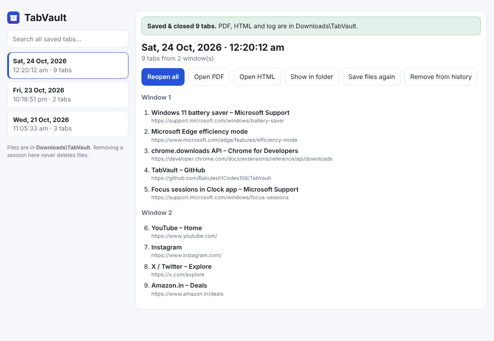

# TabVault for Windows (Chrome & Microsoft Edge)

The same TabVault, as a browser extension for **Google Chrome** and **Microsoft Edge** on Windows 10/11 (it also works on macOS and Linux).
One click saves every open tab to a clickable **PDF**, a searchable **HTML** page and a **CSV log** in `Downloads\TabVault`, then closes the tabs.

| Toolbar popup | History page |
| --- | --- |
|  |  |

## Install (2 minutes)

1. On GitHub click **Code → Download ZIP**, then right-click the ZIP → **Extract All**.
2. Open the `windows` folder and double-click **`Install TabVault.bat`**.
   It copies the extension to `%LOCALAPPDATA%\TabVault\extension`, puts that path on your clipboard and opens your browser's extensions page.
3. In the browser:
   1. Turn on **Developer mode**.
   2. Click **Load unpacked**, press <kbd>Ctrl</kbd>+<kbd>V</kbd> to paste the folder path, then **Select Folder**.
   3. Click the puzzle-piece icon and **pin** TabVault.

> If Windows SmartScreen warns about the `.bat` file, click **More info → Run anyway**, or follow step 3 manually and pick the `windows\extension` folder.
>
> Chrome may show a "Disable developer mode extensions" notice at start-up. That is normal for extensions not installed from the Web Store; click the X to dismiss.

## Use it

- Click the **TabVault** button → choose **All windows** or **This window** → **Save & close tabs**.
- Or press <kbd>Alt</kbd>+<kbd>Shift</kbd>+<kbd>A</kbd> (all tabs) / <kbd>Alt</kbd>+<kbd>Shift</kbd>+<kbd>W</kbd> (this window). Change them at `chrome://extensions/shortcuts` or `edge://extensions/shortcuts`.
- A **History** page opens showing what was saved, with **Reopen all**, **Open PDF**, **Open HTML** and **Show in folder**.
- **Timeline** opens `All sessions.html`, the same day-by-day timeline as the Mac version.
- **Folder** opens `Downloads\TabVault` in File Explorer.

## Options

| Option | Default | What it does |
| --- | --- | --- |
| Keep pinned tabs open | On | Pinned tabs (e.g. mail, calendar) are never archived or closed |
| Close tabs after saving | On | Turn off to only take a snapshot |
| Hide the download pop-up while saving | On | Keeps the browser's download bubble quiet during a save |
| Badge warning at N tabs | 30 | Shows a red tab count on the button once you pass N |
| Auto-archive daily at a time | Off | Saves & closes everything once a day, e.g. at bedtime |

## Files it creates

Everything goes to `Downloads\TabVault` (or your browser's download folder):

| File | What it is |
| --- | --- |
| `Tabs YYYY-MM-DD HH.MM.SS.pdf` | All tabs with clickable links |
| `Tabs YYYY-MM-DD HH.MM.SS.html` | Same list with filter box and "Reopen all" |
| `TabVault Log.csv` | Date, time, window, title and URL of every archived tab (opens in Excel) |
| `All sessions.html` | Timeline of every session |

## Safety & battery

- The session is stored inside the extension **before** anything else, so it can always be reopened from History.
- Tabs close **only after** the PDF and HTML have finished downloading and exist on disk. Otherwise: "Nothing was closed".
- Session files are never overwritten (a copy like `… (1).pdf` is made instead). Only TabVault's own log and timeline are refreshed.
- No network access, no tracking. No background polling: it wakes only when you click, press a shortcut, open/close a tab (badge) or at the daily time you set.
- If your browser is set to *Ask where to save each file*, you may get a Save dialog per file; turn that setting off for one-click saving.

## Differences from the Mac version

| | Mac (Safari) | Windows (Chrome / Edge) |
| --- | --- | --- |
| How you start it | Dock icon | Toolbar button or <kbd>Alt</kbd>+<kbd>Shift</kbd>+<kbd>A</kbd> |
| Pinned tabs | Can't be detected, so they are archived too | Kept open (option) |
| History | Timeline page | History page **and** timeline page |
| Daily auto-archive | — | Optional |
| PDF / HTML / CSV / timeline | Identical | Identical (shared code, see `tools/sync-core.js`) |

## For developers

`extension/core.js` is generated from `app/TabVault.js` so both platforms produce the same files. After editing the Mac app run:

```
node tools/sync-core.js
```
